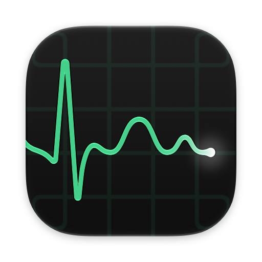

<p align="center">
  
</p>

# apple-system-mcp

A local MCP server, written in Swift, that lets Claude read the state of this Mac:
processes, CPU, memory, network interfaces, mounted volumes, open sockets, the battery and
storage activity. It ships as a Claude extension.

It calls the system's own interfaces directly — libproc, sysctl, Mach, `getifaddrs`,
`getfsstat`, IOKit — with no helper programs, no shell, no network, no write of any kind
and no third-party code: the package has no dependencies, and the MCP protocol over stdio
is implemented here with Foundation. There is nothing to configure.

Not affiliated with or endorsed by Apple Inc. The icon is the one macOS ships for the
Activity Monitor app: it is Apple's artwork, used only to show what this server reads.

## Requirements

- macOS 26 or later, Apple silicon
- Swift 6.0 or later
- A code signing identity is optional. Ad-hoc signing works; see [Signing](#signing).

## Tools

| Tool | Kind | What it does |
|---|---|---|
| `system_status` | read | Reports that the server runs and how many processes it can see and read. |
| `system_overview` | read | macOS version and uptime, chip and core layout, CPU use over a short sample, load average, memory, memory pressure and swap. |
| `system_processes` | read | Lists processes a page at a time with CPU %, memory, threads, owner and name, sorted by cpu, memory, name or pid, filtered by name, owner or parent. |
| `system_process` | read | Everything readable about one pid: state, path, owner, parent, start time, CPU rate, memory, threads, disk, descriptor count, working directory and a page of its children. Command-line arguments only on request, a window at a time when they are long. |
| `system_network` | read | Interfaces, a page at a time, with addresses, 64-bit cumulative counters and the current rate in each direction. |
| `system_volumes` | read | Mounted volumes, a page at a time, with file system, device, total size and the space an ordinary process may use. |
| `system_connections` | read | Open TCP and UDP sockets, a page at a time, with addresses, TCP state and the owning process. |
| `system_battery` | read | What the Mac runs on (mains, battery, UPS) and each battery's charge, charging state, time to empty or full, health, temperature and voltage. A desktop answers that it has none. |
| `system_disks` | read | Read and write activity of each storage driver, a page at a time: totals since boot, and bytes, operations per second and average latency over a short sample. |

## Frameworks and APIs

Apple publishes no online reference for libproc or the Mach host calls. Their contract is
the public SDK header, named below relative to `$(xcrun --show-sdk-path)/usr/include`.
The BSD calls have manual pages, which Apple archives
[here](https://developer.apple.com/library/archive/documentation/System/Conceptual/ManPages_iPhoneOS/).

| Used | For | Reference |
|---|---|---|
| `proc_listallpids`, `proc_listchildpids` | Process ids, children of a process | `libproc.h` |
| `proc_pidinfo` with `PROC_PIDT_SHORTBSDINFO`, `PROC_PIDTBSDINFO`, `PROC_PIDTASKINFO`, `PROC_PIDVNODEPATHINFO`, `PROC_PIDLISTFDS` | Parent, owner, state, start time, threads, working directory, descriptor count | `libproc.h`, `sys/proc_info.h` |
| `proc_pidpath` | Executable path | `libproc.h` |
| `proc_pid_rusage` (`RUSAGE_INFO_V6`) | Physical footprint, CPU time, disk bytes | `libproc.h`, `sys/resource.h` |
| `proc_pidfdinfo` with `PROC_PIDFDSOCKETINFO` | TCP and UDP sockets of a process | `libproc.h`, `sys/proc_info.h` |
| `sysctl` (`KERN_PROCARGS2`) | Command-line arguments, on request | [sysctl(3)](https://developer.apple.com/library/archive/documentation/System/Conceptual/ManPages_iPhoneOS/man3/sysctl.3.html) |
| `sysctlbyname` (`hw.*`, `kern.*`, `vm.*`) | Hardware, kernel version, boot time, memory pressure, swap | [sysctlbyname(3)](https://developer.apple.com/library/archive/documentation/System/Conceptual/ManPages_iPhoneOS/man3/sysctlbyname.3.html) |
| `host_processor_info` (`PROCESSOR_CPU_LOAD_INFO`) | CPU ticks per core | `mach/mach_host.h`, `mach/processor_info.h` |
| `host_statistics64` (`HOST_VM_INFO64`) | Memory page counts | `mach/mach_host.h`, `mach/vm_statistics.h` |
| `host_page_size` | Size of a memory page | `mach/mach_init.h` |
| `mach_continuous_time`, `mach_timebase_info` | Monotonic clock and the tick-to-nanosecond ratio | `mach/mach_time.h` |
| `sysctl` (`NET_RT_IFLIST2`) | 64-bit interface counters | `sys/socket.h`, `net/if.h` |
| `getifaddrs`, `getnameinfo` | Interface addresses | [getifaddrs(3)](https://developer.apple.com/library/archive/documentation/System/Conceptual/ManPages_iPhoneOS/man3/getifaddrs.3.html), [getnameinfo(3)](https://developer.apple.com/library/archive/documentation/System/Conceptual/ManPages_iPhoneOS/man3/getnameinfo.3.html) |
| `getfsstat` | Mounted volumes | [getfsstat(2)](https://developer.apple.com/library/archive/documentation/System/Conceptual/ManPages_iPhoneOS/man2/getfsstat.2.html) |
| `getloadavg` | Load average | [getloadavg(3)](https://developer.apple.com/library/archive/documentation/System/Conceptual/ManPages_iPhoneOS/man3/getloadavg.3.html) |
| `getpwuid_r` | User name from a uid | [getpwuid(3)](https://developer.apple.com/library/archive/documentation/System/Conceptual/ManPages_iPhoneOS/man3/getpwuid.3.html) |
| `IOPSCopyPowerSourcesInfo`, `IOPSCopyPowerSourcesList`, `IOPSGetPowerSourceDescription`, `IOPSGetProvidingPowerSourceType` and the `kIOPS*Key` constants | Battery and UPS state | `IOKit/ps/IOPowerSources.h`, `IOKit/ps/IOPSKeys.h` |
| `IOServiceGetMatchingServices` (`IOBlockStorageDriver`), `IOIteratorNext`, `IORegistryEntryGetRegistryEntryID`, `IORegistryEntryCreateCFProperty` (`Statistics`, `BSD Name`), `IORegistryEntryGetChildIterator` | Per-drive bytes, operations and time; the drive's BSD name | `IOKit/IOKitLib.h`, `IOKit/storage/IOBlockStorageDriver.h` |
| Foundation [`ProcessInfo`](https://developer.apple.com/documentation/foundation/processinfo), [`ISO8601DateFormatter`](https://developer.apple.com/documentation/foundation/iso8601dateformatter), [`FileHandle`](https://developer.apple.com/documentation/foundation/filehandle) | Own pid and name, timestamps, the diagnostic log on stderr | |
| Foundation `JSONDecoder`, `JSONEncoder`, `FileHandle` | The [protocol](https://modelcontextprotocol.io/specification/2025-11-25) over stdio: JSON-RPC 2.0, one message per line (`initialize`, `ping`, `tools/list`, `tools/call`) | |

## The rules worth knowing before you use it

**An ordinary process sees every process, but reads only its own user's.** The server runs
as you. macOS lets such a process list every process and read its name, path, owner and
parent, but returns CPU, memory, threads, disk, descriptors and sockets only for processes
owned by the same user. Everything else shows `n/a`, and every listing says how many rows
are affected. Running the server as root would lift that; it is not a mode this server
offers. In a measurement on one machine, about three quarters of the processes were
readable.

**Every result is bounded, and says what it left out.** Processes, sockets, interfaces,
volumes, storage drivers and a process's children come one page at a time, in an order the
result states; a long command line comes one window at a time. When a result does not hold
everything, its first lines say how much there is and the exact arguments that return the
rest: `limit` and `offset` for rows, `character_offset` and `max_characters` for a command
line. A number outside its range (`limit`, `offset`, `sample_ms`, a window) is moved to the
nearest allowed value and the first lines say which one was used. A pid or a port outside
its range is refused instead, because the nearest one would be another process or port.
The sizes are constants in `ToolCatalog.swift`, which the schemas and descriptions quote.
No result is longer than `ToolStandard.longestResult`: each tool keeps to that itself, and
the protocol layer cuts, with a notice, any result that did not.

**Every percentage and rate is two readings.** CPU use, a process's CPU % and network and
disk rates are computed between two readings `sample_ms` apart (by default 500 ms for CPU
and 1000 ms for network and disk rates, up to 5000). The call takes at least that long. CPU % is a percentage of **one core**: 100 is one core busy, and a
process on four cores can show 400.

**CPU time is not in nanoseconds.** libproc reports it in Mach ticks, and on Apple silicon
one tick is 125/3 ns. Reading the field as nanoseconds makes every process look about 40
times less busy than it is. `SystemCalls.nanoseconds(fromMachTicks:)` converts it, and a
test burns a known amount of CPU to catch a regression.

**Memory "in use" is an approximation.** The system documents no formula for it. The figure
here is app memory (anonymous pages that are not purgeable) plus wired plus compressed
pages, and the output says so. The memory pressure level is the system's own verdict and
the better signal.

**Command-line arguments are opt-in.** `system_process` returns them only with
`include_arguments`, because they can carry tokens and passwords. Values that look like
secrets are masked on a best-effort basis (flags and `key=value` names such as `--token`,
`API_KEY=`, well-known credential prefixes, passwords inside URLs), which is never a
guarantee. A process's environment is never read.

**Battery and disk readings carry no identifiers.** The battery's serial number, which the
system publishes next to its charge, is never read, and a drive is named by its BSD name
(`disk0`), never by model or serial number. Cycle count is not offered: the documented
power-source interface has no key for it.

**Disk counters are per drive and since boot.** Rates and average latency come from two
readings, as everywhere else; `sample_ms` 0 returns totals only.

**Network counters are per interface, not per process.** The system offers no per-process
traffic figure through these interfaces.

**Counters use 64 bits.** The 32-bit counters that hang off `getifaddrs` wrap at 4 GiB,
which a busy interface passes in minutes, so interface totals come from the routing
sysctl instead.

**This server has no write of any kind.** It cannot stop, signal or reprioritise a
process, and nothing it reads is stored.

## Install

### 1. Build the bundle

```bash
./scripts/pack.sh
```

That checks the three version strings agree, builds an arm64 release binary, signs it,
checks the embedded `Info.plist`, and writes `dist/apple-system-mcp.mcpb`. It fails rather
than shipping a bundle that would silently misbehave.

### 2. Install it

Open `dist/apple-system-mcp.mcpb` with Claude. Then **quit Claude Desktop completely and
reopen it** — installing does not replace a server process that is already running, and
the old one keeps answering.

**Bump the version before every new bundle.** The installer keys on the manifest `version`
alone. A different build under the same version makes it conclude the extension is already
installed, and its only offer is "Uninstall", which removes it.

### Signing

`swift build` leaves a signature the linker generated, flagged `linker-signed`, which
carries no designated requirement. `pack.sh` re-signs the binary. By default that is
ad-hoc, which works but changes the code identity on every rebuild. To keep a stable
identity:

```bash
security find-identity -v -p codesigning   # copy the 40-character hash of an Apple Development or Developer ID Application identity
MCPB_SIGN_IDENTITY="<identity hash>" ./scripts/pack.sh
```

Pass the hash, not the certificate's name: `pack.sh` prints the identity it signs with,
and the name is yours.

This server reads nothing that macOS gates behind a privacy permission, so the identity
matters for stability and distribution, not for a consent dialog.

For something to distribute, `MCPB_HARDENED=1` adds the hardened runtime and a secure
timestamp, which notarisation requires. No entitlements are needed.

## Tool switches

Every tool can be turned on and off individually in Claude Desktop, because the bundle
declares them in its manifest. That is where policy lives, not in this code. **Reinstalling
may reset the switches.** Check them after every install.

## Manual registration instead

```json
{
  "mcpServers": {
    "System": {
      "command": "/absolute/path/to/apple-system-mcp/.build/release/apple-system-mcp"
    }
  }
}
```

You lose the per-tool switches.

## Known limits

- **Other users' and the system's processes are visible but not readable.** Their CPU,
  memory, threads, descriptors and sockets show `n/a`. Sockets owned by a service that runs
  as root or as another user do not appear in `system_connections`.
- **No CPU frequency and no thermal state.** `hw.cpufrequency` is empty on Apple silicon and
  there is no sysctl for the thermal state. Only the battery's own temperature is reported.
- **No per-process network traffic and no GPU or energy figures.**
- **A pid is a moment in time.** Pids are reused, and a process that exits between two
  readings has no rate. Use a pid right after listing it.
- **Rates are averages over the sample.** A burst shorter than `sample_ms` is smoothed.
- **Each page is a new reading.** A call reads the machine again, so a row can move between
  two pages, above all when processes are ordered by CPU. Order by pid or name to see each
  process exactly once.

## Development

```bash
swift build
swift test
```

The suite runs against an in-memory double of the machine. A small suite, described in
`CLAUDE.md`, reads the test process itself and machine-wide totals to catch the faults a
double cannot: a wrong unit, a mis-decoded struct, a miscounted buffer. Manual checks
against a real process table are the owner's call; see `CLAUDE.md`.

## Licence

MIT.
